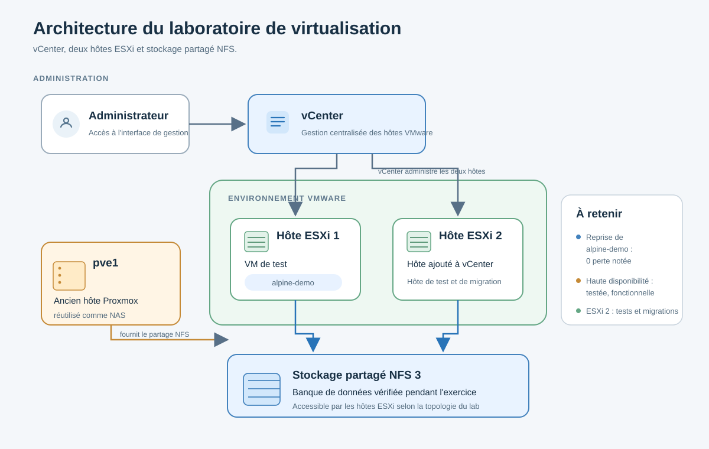
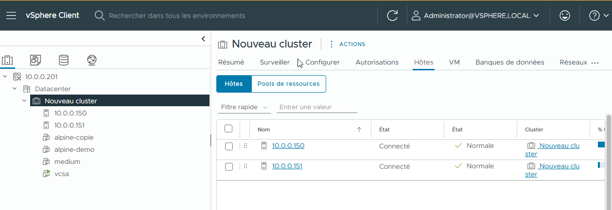
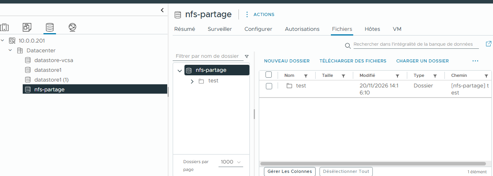
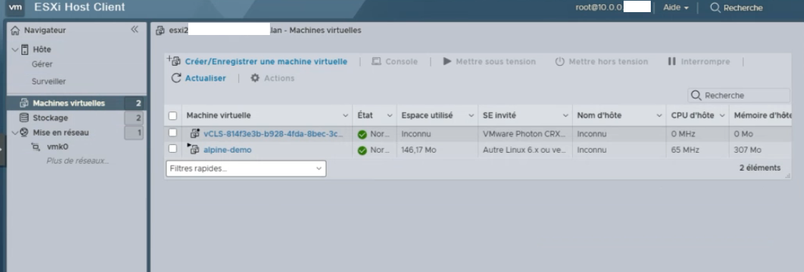

# Projet de virtualisation

Ce dépôt présente mon laboratoire de virtualisation réalisé dans le cadre du module **Administrer et sécuriser les infrastructures virtualisées**. J'y ai étudié Proxmox VE, VMware ESXi et vCenter, puis monté une infrastructure vSphere à deux hôtes avec stockage partagé, migration de machine virtuelle et haute disponibilité.

## Objectifs

- Comprendre le fonctionnement d'un hyperviseur et d'un cluster.
- Administrer des hôtes de virtualisation et contrôler les accès.
- Centraliser deux hôtes ESXi dans vCenter.
- Mettre en place un stockage partagé accessible par les hôtes.
- Tester la migration d'une VM et la haute disponibilité.
- Relier les choix techniques aux besoins de reprise d'activité.

## Architecture du laboratoire

L'environnement VMware comprend vCenter, deux hôtes ESXi et un stockage partagé NFS 3. Le serveur `pve1`, auparavant utilisé comme hôte Proxmox, a été réaffecté au rôle de NAS. Les deux hôtes ESXi sont ajoutés à l'inventaire vCenter et utilisent la banque de données partagée. ESXi 2 sert aux tests et aux migrations. La VM `alpine-demo` est utilisée pour vérifier les opérations de reprise et de migration.

## Travail réalisé

### 1. Notions de virtualisation et étude de cas

Le travail commence par les notions d'hyperviseur, de machine virtuelle, de cluster, de stockage et d'administration. L'étude de cas prend comme contexte une PME d'environ 40 personnes et six serveurs physiques. La virtualisation permet de séparer les services du matériel et facilite le déplacement ou la restauration des machines.

Les choix d'infrastructure sont également abordés du point de vue de l'exploitation : support contractuel, écosystème, responsabilités en cas d'incident, correctifs et séparation des privilèges.

### 2. Cluster Proxmox VE

J'ai étudié la création et l'administration d'un cluster Proxmox VE : rôle des nœuds et du quorum, stockage local `local` et `local-lvm`, sauvegardes et migration. Nous avons comparé les snapshots, la suspension et l'arrêt d'une VM, ainsi que leurs effets sur le service et la copie obtenue.

L'administration est organisée autour de comptes nominatifs et de privilèges attribués selon le rôle. L'accès `root` reste réservé aux opérations qui le nécessitent.

### 3. Administration d'un hôte ESXi

J'ai ensuite installé et administré un hôte ESXi autonome, créé un utilisateur et configuré les éléments nécessaires à l'exercice. La partie réseau porte notamment sur les groupes de ports, les VLAN et les règles de sécurité du commutateur virtuel. Les accès d'administration et l'activation de SSH sont abordés dans le contexte du laboratoire.

### 4. vCenter et stockage partagé

Deux hôtes ESXi ont été ajoutés dans vCenter afin de les administrer depuis un inventaire commun. L'ancien hôte `pve1` a été réutilisé comme NAS. Un partage NFS 3 a été présenté aux hôtes, puis ajouté comme banque de données et vérifié depuis vCenter.

La mise en place couvre aussi le démarrage automatique des machines virtuelles et le provisionnement dynamique des disques.

### 5. Migration et haute disponibilité

La VM `alpine-demo` a servi aux essais de migration entre les hôtes. Les notes consignent un test sans perte observée. Elles distinguent la migration d'une VM et la migration à chaud, qui nécessite la configuration de vMotion.

La haute disponibilité a été activée et testée dans le cluster vSphere. Le test a fonctionné : la VM peut être redémarrée par l'infrastructure lorsqu'un hôte tombe en panne. La durée exacte de reprise n'a pas été mesurée dans les notes.

## Résultats des tests

| Vérification | Résultat |
|---|---|
| Banque de données NFS 3 | Ajoutée et vérifiée depuis vCenter. |
| Migration de `alpine-demo` | Test concluant ; aucune perte observée pendant l'essai consigné. |
| Haute disponibilité vSphere | Activée et testée avec succès dans le laboratoire. |

## Captures du laboratoire

### vCenter : les deux hôtes ESXi

### Stockage partagé NFS

### Migration de la machine virtuelle

## Reprise d'activité : RTO et RPO

L'étude de cas aborde une sauvegarde quotidienne, avec un **RTO cible d'une heure** et un **RPO de 24 heures**. Le RTO correspond au délai de remise en service visé ; le RPO correspond à la quantité maximale de données que l'on accepte de perdre. Ce sont les objectifs du scénario étudié, distincts des résultats des tests de migration et de haute disponibilité.

## Sécurité et exploitation

Le laboratoire met l'accent sur la protection des interfaces d'administration, les mises à jour de l'hyperviseur, la séparation des privilèges et la fermeture par défaut des accès réseau inutilisés. Les services d'administration activés pour les besoins de dépannage doivent être limités au contexte et à la durée nécessaires.

## Conclusion

Ce laboratoire m'a permis de passer de la découverte des hyperviseurs à l'administration d'une infrastructure VMware centralisée. J'ai configuré le stockage partagé, testé la migration d'une VM et validé la haute disponibilité. Il met aussi en évidence les conditions nécessaires à une reprise fiable : stockage accessible par les hôtes, réseau correctement configuré, privilèges maîtrisés et tests réguliers.

